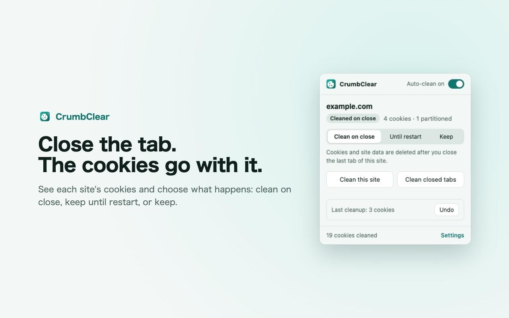
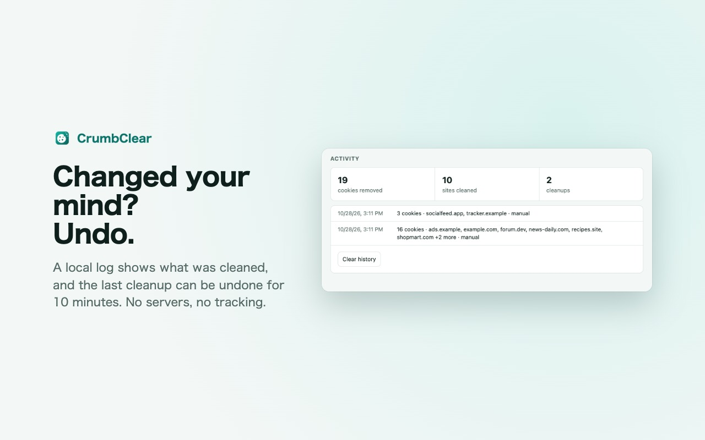

<p align="center">
  
</p>

<h1 align="center">CrumbClear</h1>

<p align="center">
  <b>Auto delete cookies when you close a tab.</b><br>
  A free, open-source cookie cleaner for Chrome. Sites you trust stay logged in.
</p>

<p align="center">
  
  
  
  
  
</p>

<p align="center">
  <a href="https://chromewebstore.google.com/detail/aggadloggaflppnahldcfmhhedonhjia?utm_source=github&utm_medium=readme"><b>Install from the Chrome Web Store</b></a> ·
  <a href="https://sentimenta1ist.github.io/crumbclear/privacy.html">Privacy policy</a> ·
  <a href="https://github.com/Sentimenta1ist/crumbclear/issues">Report an issue</a>
</p>

<p align="center">
  <picture>
    <source media="(prefers-color-scheme: dark)" srcset="store/screenshots/en/4-dark.jpg">
    
  </picture>
</p>

## Why

Close the last tab of a site, and CrumbClear deletes the cookies and site data it left behind. Trackers embedded on that site go with it. Sites you put on your Keep list are never touched, so you stay logged in where it matters.

It started as a replacement for Cookie AutoDelete, which stopped working when Chrome turned off Manifest V2 extensions. You can import your old lists in one step.

## Features

| | |
|---|---|
| 🧹 **Cleans on tab close** | Cookies and, optionally, localStorage, IndexedDB, cache storage and service workers, after a delay you choose (instantly to 15 minutes). |
| 📌 **Keep and Until restart lists** | Keep sites forever or until the next browser start. One click in the popup, or patterns like `*.example.com`. |
| 🧩 **Partitioned cookies** | CHIPS cookies are cleaned together with the site they belong to. |
| 🛟 **Safe first run** | Nothing is deleted after install until you pick the sites you want to stay logged in to. |
| 🔑 **Sign-in keeps working** | Google, Microsoft, Apple, GitHub and Okta sign-in are on the Keep list from the start. Remove any you don't want. |
| 📥 **Cookie AutoDelete import** | Whitelist becomes Keep, greylist becomes Until restart. Plain text lists work too. |
| 🔢 **See what happens** | Cookie count on the icon, colored by what will happen to the site, and a local activity log. |
| ↩️ **Undo** | Cleaned too much? The last cleanup's cookies can be put back for 10 minutes. |
| 🌍 **Six languages** | English, Deutsch, 日本語, 简体中文, 繁體中文, Polski. |

<p align="center">
  <picture>
    <source media="(prefers-color-scheme: dark)" srcset="store/screenshots/en/5-dark.jpg">
    
  </picture>
</p>

## Moving from Cookie AutoDelete

1. In Cookie AutoDelete, open Settings and choose **Export**.
2. Install CrumbClear. The settings page opens on its own.
3. Under **Import and export**, choose **Import lists…** and pick the exported file.
4. Pick any other sites to keep, then turn on auto-clean.

CrumbClear is an independent project, not affiliated with Cookie AutoDelete.

## Privacy

- No servers, no analytics, no ads, no network requests. A strict Content Security Policy blocks network access from the extension's pages.
- Settings, lists and the activity log stay on your device in `chrome.storage`. Cookies for Undo are held in memory only, for 10 minutes.
- No content scripts: the extension never reads the pages you visit.

Full policy: [privacy.html](https://sentimenta1ist.github.io/crumbclear/privacy.html).

## Install

- **Chrome Web Store:** [CrumbClear: Auto Delete Cookies](https://chromewebstore.google.com/detail/aggadloggaflppnahldcfmhhedonhjia?utm_source=github&utm_medium=readme).
- **From source:** run `scripts/build.sh`, unzip `dist/crumbclear-<version>.zip`, open `chrome://extensions`, turn on Developer mode, click **Load unpacked** and choose the unzipped folder.

<details>
<summary><b>Development</b></summary>

### Structure
- `src/background.js` — service worker: tab events, cleanup, badge, popup messages
- `src/lib.js` — pure decision logic (what to delete, list matching, imports)
- `src/popup.*`, `src/options.*`, `src/ui.css` — UI; `src/i18n.js` and `_locales/` — translations
- `src/vendor/tldts.js` — Public Suffix List (tldts 7.4.18, MIT), so `mail.google.com` and `accounts.google.com` count as one site
- `test/` — Node tests; `scripts/build.sh` — store zip
- `privacy.html` — privacy policy; `index.html` — landing page; `LISTING.md` — store listing text; `store/` — store images; `icons/src/` — icon sources

### Tests and build
```
node --test test/*.test.mjs
scripts/build.sh
```
`background.test.mjs` runs the real service worker against an in-memory fake of the chrome APIs; `pages.test.mjs` runs the popup and options scripts against a small fake DOM. The build runs the tests and writes a zip with only `manifest.json`, the four icons, `_locales/` and `src/`.

</details>

## License

MIT, see [LICENSE](LICENSE).
